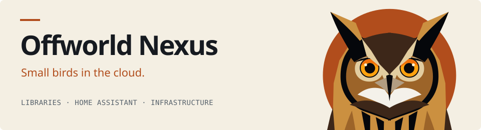

<picture>
  <source media="(prefers-color-scheme: dark)" srcset="brand/header-dark.svg">
  <source media="(prefers-color-scheme: light)" srcset="brand/header-light.svg">
  
</picture>

Open-source tools for the server, the network and the home. Each project is a
small bird: it does one thing and is built to last.

## Libraries

| Project | What it does | Status |
| --- | --- | --- |
| [**livezip**](https://github.com/OffworldNexus/livezip) | Memory-bound, streamable ZIP64 archives from any source: disk, HTTP, memory, S3. · [Docs](https://offworldnexus.github.io/livezip/) | Stable · in production for years |
| [**bird-id**](https://github.com/OffworldNexus/bird-id) | Deterministic Saul Bass bird avatars from an email address, in pure Rust. | Stable |

## Home Assistant

| Project | What it does | Status |
| --- | --- | --- |
| [**Screensight**](https://github.com/OffworldNexus/screensight) | *Small bird. Wide view.* A calm, always-on status panel for your home on a Raspberry Pi and a touchscreen. | 🥚 Incubating |
| [**accioid**](https://github.com/OffworldNexus/accioid) | Evaluates checks about your home and turns what it finds into actions. | 🥚 Incubating |

## Flagship

| Project | What it does | Status |
| --- | --- | --- |
| [**Tunnel Weaver**](https://github.com/OffworldNexus/tunnel-weaver) | *Small bird. Strong connections.* Exposes local services on public domains, with automated TLS and end-to-end authentication. | 🥚 Incubating |
| [**blastit**](https://github.com/OffworldNexus/blastit) | *Small bird. Small blast radius.* A WSGI server that runs each route in its own process, under its own user, with only the SQL it is granted. · [Docs](https://offworldnexus.github.io/blastit/) | 🥚 Incubating |

🥚 **Incubating** projects are being built in the open: expect them to change.
